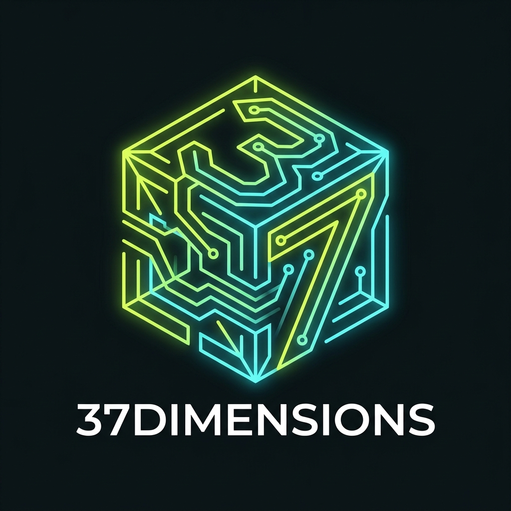

# 37dimensions · Rochecorbon 🚀

<p align="center">
  
</p>

> **Micro-makerspace intergénérationnel à Rochecorbon (Indre-et-Loire - 37)**  
> *Fabriquer. Comprendre. Partager.*

Site vitrine moderne, responsive et accessible pour l'association **37dimensions**.

---

## 🌟 Présentation du projet

L'association **37dimensions** démocratise l'accès à :
- **L'Intelligence Artificielle** (ChatGPT, Midjourney, modèles open-source locaux, prompt engineering éthique)
- **La Fabrication Numérique** (Impression 3D FDM, modélisation Fusion 360, découpe vinyle)
- **L'Électronique & l'IoT** (Arduino, Raspberry Pi, capteurs connectés, domotique libre)
- **La Démarche Slow-Tech & Réparation** (Repair-café, démontage, rétro-ingénierie, durabilité)

### Deux Piliers d'Ateliers
1. **Pôle Adultes & Makers** : Prototypage, IA appliquée, modélisation 3D et atelier "Boîte Noire".
2. **Fablab Junior (8-17 ans)** : Coding Club (Scratch / Python), robotique d'éveil, aéromodélisme/drones et animation stop-motion.

---

## 🎨 Charte Graphique & Identité
- **Logo officiel** : Le Cube Isométrique Circuit "37" (`logo.jpg`) combinant volume 3D, pistes électroniques et le chiffre 37.
- **Thème** : Sombre, moderne, "Atelier / Maker / Cyber-Tech doux"
- **Palette** :
  - Fond : `#0a0c0d` (Anthracite très sombre avec trame technique)
  - Panneaux / Cartes : `#121617`
  - Accents lumineux : Vert Lime `#c8ff46`, Cyan `#58e6df`, Rose `#ff5aa8`
- **Typographie** : Sans-serif moderne (Inter) et touches techniques en monospace (JetBrains Mono).

---

## 📂 Structure du Répertoire

```
.
├── index.html            # Landing page monopage sémantique et accessible
├── style.css             # Feuille de styles CSS3 moderne (variables, flexbox/grid)
├── script.js             # Interactions légères (menu mobile, smooth scroll, validation)
├── logo.jpg              # Logo officiel 37dimensions (Cube Isométrique Circuit 37)
├── README.md             # Documentation du projet
└── .gitignore            # Fichiers exclus du versionnement
```

---

## 🚀 Utilisation locale

Ouvrez simplement le fichier `index.html` dans n'importe quel navigateur moderne :

```bash
# Avec Chrome
google-chrome index.html

# Avec Firefox
firefox index.html

# Ou avec l'outil système par défaut
xdg-open index.html
```

---

## 📍 Localisation
**Rochecorbon (37210)**, Indre-et-Loire, Touraine, France.

## 📄 Statut
Association loi 1901 en constitution.
